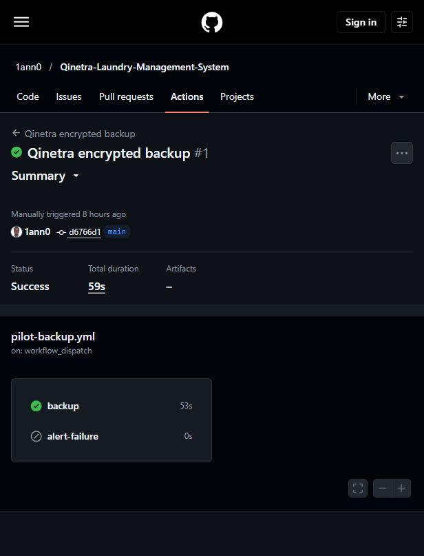

# Hosted backup qualification and activation

Verified 14 October 2026. [Actual GitHub run 38456601715](https://github.com/1ann0/Qinetra-Laundry-Management-System/actions/runs/38456601715) completed successfully on 13 October at 22:40:41 Nairobi. It was a manual qualification, not a scheduled run. Workflow main revision: `d6766d1ee2249e0616cb1389d1420933c4ea799c`; pinned operations revision: `c06dc6290394d607dccc927c2046a2a2bb77d104`.

## Actual proof

- The backup job ran and succeeded; it was not skipped. Checkout, Python setup, monitor start, operations dependencies, pinned PostgreSQL client, encrypted export/authenticated Drive readback and monitor completion all succeeded.
- The separate deliberate-failure job and the schedule-only retention admission step were correctly skipped for manual qualification. The archive step itself used the verified environment cleanup switch `true`; its implementation cannot return success before required retention completes.
- Fresh protected nonsecret readback: pilot project `istweeaqtykwfuhntgik`, cleanup `true`, qualification `true`. The daily switch was initially `false` and was deliberately set to `true` on 14 October after successful qualification; independent readback confirmed `true`.
- Workflow artifacts are empty. No archive, key, private settings, credential-bearing logs or customer records were fetched by the agent. The private installer PASS and earlier restore/email/retention results remain human-reported evidence.

## Laptop independence

The human could not switch the laptop off and explicitly requested an alternative. The real job used GitHub's fresh `ubuntu-24.04` hosted runner, its protected environment secrets and its temporary directory. It connected directly to hosted Supabase, Google Drive and Healthchecks. The export validates a Supabase database/pooler destination; the key is supplied from the protected environment, not a laptop file. There is no self-hosted runner, laptop tunnel or dependency on a laptop service.

The combination of actual cloud execution and inspected inputs establishes laptop independence. An observed powered-off test was not performed; no numerical reliability probability is claimed.

## Daily operation

Nightly backups are enabled for `0 19 * * *` UTC, corresponding to 22:00 Nairobi. The next scheduled run after activation is expected on 14 October; GitHub can delay scheduling. The human-confirmed independent monitor uses 22:00 Nairobi with two hours' grace and company email alerts. Record the first actual scheduled run separately; it has not yet been observed. Investigate a failure or missing-run email rather than assuming the schedule ran.

To stop automatic jobs, set repository variable `QLMS_HOSTED_BACKUP_ENABLED=false`. Preserve verified Drive archives and the two private recovery copies. Do not regenerate keys, reinstall settings or repeat Google consent.

The earlier measured archive was 103,411 bytes; 90 equal-size copies project to 9.31 MB of the free 5 GB. This is a snapshot projection, not a growth forecast or the measured size of this hosted run. Capacity checks retain the agreed 1 GB reserve.

Screenshot 65 is the real public GitHub run summary, captured without opening logs. It demonstrates successful manual cloud execution, not first scheduled execution or full-system acceptance.

## Live application readback, 14 October

Anonymous login returns 200 with private no-store, HSTS and nosniff headers. API readiness returns 200/ready after a 33.531-second idle wake-up. Cloudflare still serves version `cf2c15f9-90c0-4a53-a6dc-3cc7eefbaadd` at 100%, deployment `5732c263-0031-41aa-bdbd-470a5a52cc81`; Render remains Live `dep-db5pnics728c738kq2d0` from API source `97686708c2f6e4facf574054850847b50bd0dbbd`. These checks did not authenticate or write customer data. Free hosting can wake slowly; retain the paper/receipt fallback.

Screenshot SHA256: `995F4A89649EC5C61071AD4549F15B7AC0E5B5F54735ED119982008C787F9745`.
