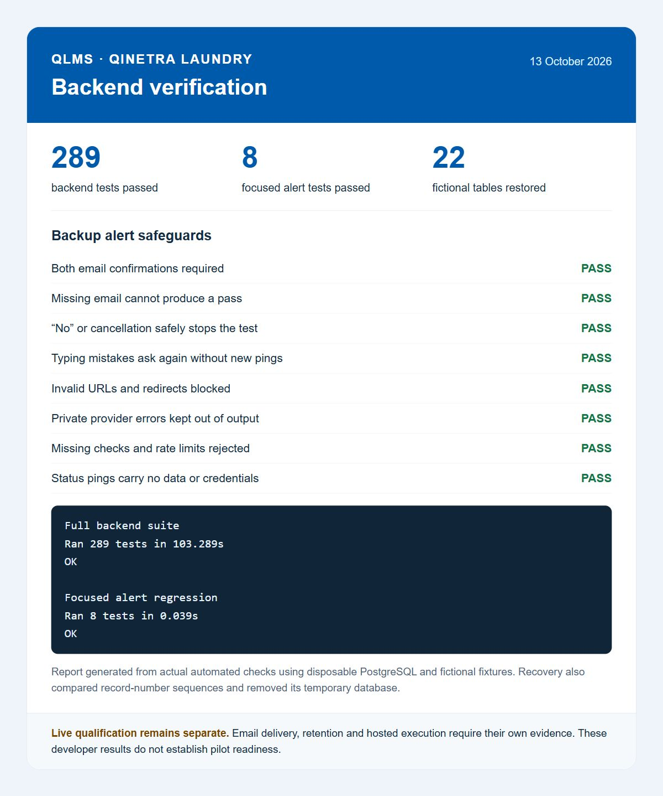

# Backup email qualification and test evidence — 13 October 2026

Actual failure and missing-run delivery passed. The human explicitly authorized local use of only the existing Healthchecks monitor URL, without displaying or saving it in output. A temporary runner selected that one field, reused the existing allowlisted empty status-ping helper, and used no Google credential, database password or recovery key. The runner was first checked against fictional input, then removed after the final recovery ping. The exception is closed; future private operations remain human-only unless separately authorized.

| Actual phase | Evidence |
| --- | --- |
| Deliberate failure | Success/failure HTTP acknowledgments around 16:16 Nairobi. Human confirms a new Up and Down email. |
| Missing entire run | Recovery acknowledged around 16:19 Nairobi, then no pings for over two minutes. Human confirms a new missing-run Down email after that recovery. |
| End of test | Final recovery acknowledgment around 16:23 Nairobi. No further test pings are scheduled. |

These are provider acknowledgments plus explicit human delivery confirmations, not agent mailbox inspection. No email body, private URL, key, credential or customer record was included in the evidence. The human subsequently confirms final daily monitor settings saved: Cron `0 22 * * *`, Africa/Nairobi, two-hour grace, check name QLMS daily backup. Actual backup scheduling remains disabled; a configured monitor does not prove an automated backup has run.

The earlier failed confirmations exited on a spelling mismatch before sending recovery, so they never started the missing-run phase. A fictional regression reproduced that failure. The helper now accepts `YES`, preserves the previous `RECEIVED` confirmation, asks again on a typo without sending another ping, and safely stops on No, EOF or cancellation. Both actual emails are still required; this is not automatic acceptance.

Fresh developer verification:

- Full disposable PostgreSQL backend suite: **289 tests, 103.289 seconds, OK**.
- Compatible migration chain, repeated application and empty-schema restore passed.
- Fresh disposable recovery helper restored and compared **22 fictional tables and sequence values**, then removed its temporary container. Full recovery rehearsal: **23.2 seconds**. This is separate from the human's actual private restore timing, which was not supplied.
- Focused named alert regression: **8 tests, 0.039 seconds, OK**. Cases cover both delivery confirmations and silence, missing email/secret-safe exceptions, No/cancellation, typo retry without another ping, invalid URL/redirect refusal, private provider errors, provider not-found/rate-limit refusal, and empty status-only requests.

The screenshot is a browser capture of a report generated from actual developer test output, not a screenshot of the live monitor or a claim of pilot readiness. It contains no private URL, real account credential or customer data. It is prepared for the user's future LinkedIn post; nothing was published. [Machine-readable evidence](diagrams/evidence/qlms-backend-test-results-20261013.json).

Still required: actual retention rehearsal, qualified default-branch publication/protected hosted secrets, hosted PC-off backup and deliberate daily activation. No application/schema deployment or real-data gate was changed by this increment.
